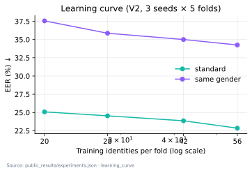
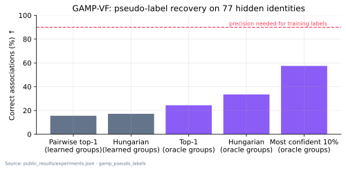
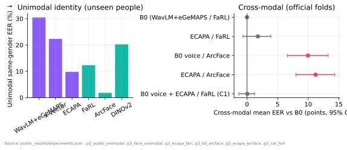
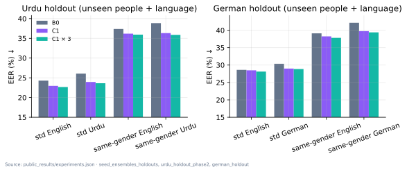
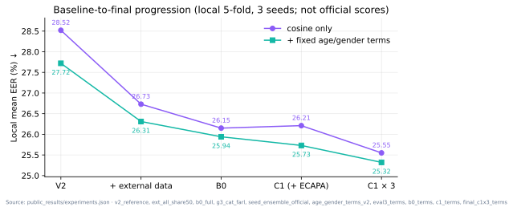
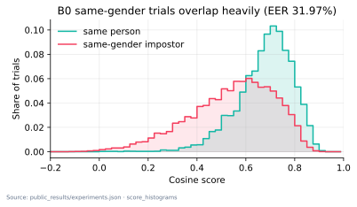

# Cross-Lingual Face–Voice Association Through Complementary Acoustic and Visual Representations

*Technical report of an independent research project for the FLAG 2027 challenge (an ICASSP 2027 Grand Challenge). This report has not been peer reviewed. All numbers come from `public_results/experiments.json`, which cites the original result files. EER is given in percent; lower is better.*

## Abstract

We study face–voice verification across languages and under gender-controlled trials.
- **Representation:** frozen FaRL face embeddings and frozen WavLM all-layer voice features, aligned by small regularised projection heads trained with a symmetric supervised contrastive loss.
- **Data:** training expanded from 70 to 301 identities.
- **Official results:** our best verified CodaBench evaluation score is 28.84% mean EER (the organisers' baseline scored 35.32%).
- **Diagnostics:** identity-optimised encoders are far better *unimodally* (ECAPA-TDNN: 9.8% vs 30.5% same-gender EER across recording sessions; ArcFace: 1.8% vs 12.3%), yet they hurt cross-modal verification (ArcFace +9.96, ECAPA alone +1.77 EER points).
- **Central result:** appending frozen ECAPA speaker embeddings to the WavLM + eGeMAPS voice input is neutral on English validation folds but improves unseen-language same-gender EER on two held-out languages: Urdu −2.49 [−3.93, −1.01] and German −2.35 [−4.38, −0.30].
- **Controls:** random features and speaker-shuffled embeddings both remove the gain. Alternative fusion schemes do not beat concatenation.
- **Negative result:** a pseudo-labelling framework (GAMP-VF) fails because cross-modal matching is too weak to provide reliable labels.
- **Final system:** a three-seed ensemble with fixed age/gender score terms reaches 25.32% local mean EER (B0: 25.94%). It has not been submitted.

## 1. Introduction and problem formulation

- **Task:** given a face image *f* and a voice clip *v*, output a score *s(f, v)*, small if they belong to the same person.
- **FLAG 2027 cells:** a standard track (impostors of any gender) and a gender-controlled track (impostors share the speaker's gender), each for English (seen in training) and Bangla (unseen; Bengali speech must not be used for training).
- **Metric:** EER, averaged over the four cells.
- **Why it's hard:** a voice does not determine a face. What can transfer are attributes both reflect, such as sex, age, body build and possibly morphology. The gender-controlled track removes the strongest of these, and the unseen-language cells test whether the voice representation is language-robust.

**Contributions** (ours, as opposed to established techniques):
1. A strictly identity-disjoint local validation (5 folds × 3 seeds, fixed trial files, paired identity bootstrap) that predicted official changes closely.
2. A controlled study showing that unimodal identity quality and cross-modal association quality diverge.
3. Two unseen-language holdouts (Urdu for development, German for confirmation) and evidence that complementary speaker embeddings improve unseen-language verification.
4. A documented negative result for pseudo-labelling under weak cross-modal signal.

## 2. Related work

- **Face–voice association:** Nagrani et al. (2018); multilingual benchmarks MAV-Celeb (Nawaz et al., 2021) and the FAME challenges.
- **The challenge baseline**, Fusion and Orthogonal Projection (FOP; Saeed et al., 2022), learns a joint embedding with orthogonality constraints.
- **Later systems:** a learned fusion/matching head after alignment (FAA, arXiv 2404.09509), and precise alignment with gated fusion and hyperbolic embeddings (PAEFF, arXiv 2505.17002).
- **Representations:** FaRL (Zheng et al., 2022) for faces; WavLM (Chen et al., 2022), ECAPA-TDNN (Desplanques et al., 2020) and eGeMAPS (Eyben et al., 2016) for voices.
- **Training objective:** supervised contrastive learning (Khosla et al., 2020).

## 3. Datasets and evaluation protocol

- **Official training set:** 70 identities (40 men, 30 women), 6,485 face–voice pairs, English only.
- **External training data:** MAV-Celeb v1 (English + Urdu, 64 identities), MAV-Celeb v3 (English + German, 50) and VoxCeleb2-test (117), giving 231 identities and 29,702 pairs after filtering:
  - frozen VoxLingua107 language ID, dropping any Bengali-like clip;
  - face-outlier removal;
  - duplicate checks against official identities.
- **External data is used for training only.**

| Protocol | Definition | Role |
|---|---|---|
| Local 5-fold | 70 official people in 5 identity-disjoint folds of 14; fixed trial files (3 genuine + 3 impostor faces per voice clip, any-gender and same-gender); 3 seeds × 5 folds × 90 epochs; paired identity-level bootstrap | all decisions |
| Urdu holdout | per fold, 1/5 of MAV-Celeb v1 people held out, all Urdu removed from training | development |
| German holdout | the same with MAV-Celeb v3 and German; candidates frozen beforehand | confirmation only |
| CodaBench | official evaluation phase 1 | finished systems only |

## 4. Baseline architecture (V1 → V2)

- **V1:** FaRL faces and WavLM-SV x-vectors with ArcFace-regularised projectors, 31.7% local mean EER (best epoch).
- **V2** replaces the x-vector with the mean of all 13 WavLM hidden states and trains with symmetric SupCon (τ = 0.07) plus a 0.25-weighted pair-alignment loss.
- **V2 projectors:** z-score → noise σ = 0.1 → input dropout 0.2 → Linear 256 → LayerNorm → GELU → dropout 0.3 → Linear 128 → L2 normalisation.
- **Result:** V2 improves both tracks significantly (standard −2.9 [−5.5, −0.2], gender −3.9 [−7.3, −0.5]) and scored 29.11% on the dev leaderboard, against 36.92% for the baseline.

## 5. Experimental investigation with 70 identities

All runs were paired against V2 (22.88 / 34.17 / 28.52 standard / gender / mean), 3 seeds × 5 folds:

| Change | Mean Δ [95% CI] |
|---|---|
| acoustic augmentation (25% clean) | +1.10 [+0.05, +2.09] |
| hyperbolic embeddings, τ = 0.1 | −0.52 [−1.66, +0.22] (standard −1.01, significant) |
| learned WavLM layer weights | −0.08 |
| per-clip layer attention | +1.84 [+0.52, +3.24] |
| ECAPA instead of WavLM | +3.24 [+0.75, +5.99] |
| WavLM + ECAPA | +0.30 [−1.29, +1.70] |
| bias-corrected age/gender score terms | −0.80 [−1.18, −0.17] (adopted; CodaBench eval #2 = 30.17) |

- **The pattern:** with about 35 people per gender, extra inputs and capacity added variance rather than signal.
- **Learning curve:** about −1.6 EER points per doubling of training identities (Fig. `fig_learning_curve`).

## 6. Dataset expansion and B0

- **External data:** adding all external identities with a 50% share of official identities per batch improves local mean EER by −1.79 [−3.45, −0.26]; CodaBench eval #3 = 28.84 (−1.33 vs eval #2).
- **B0** adds three components:
  - eGeMAPS functionals (88-d) appended to WavLM (856-d voice input);
  - shared trait heads (age, build, gender);
  - a gradient-reversal language adversary and cross-lingual alignment.
- **Result:** 26.15 local mean (25.94 with terms), −0.57 [−1.38, +0.23] vs the eval #3 model.

## 7. GAMP-VF: a negative result

**Hypothesis:** speaker/face prototypes, gender-aware hard negatives and pseudo-labels from clustering and graph matching (Hungarian, Sinkhorn) sharpen same-gender discrimination.

- **Prototype losses:** neutral or worse.
- **Same-gender partner sampling:** gender −0.41 [−1.01, +0.31] on English, but no gain on the Urdu holdout.
- **Hidden-association simulation** (77 identities): learned clustering fragmented speakers. Even with *oracle* grouping, voice → face matching reached 24% top-1 (34% Hungarian), and the most confident 10% of matches were 57% correct, against the ~90% needed for training labels (Fig. `fig_gamp_pseudo_labels`).

## 8. Unimodal versus cross-modal identity

- **Voice:** on unseen bilingual people, B0's voice input reaches 30.5% same-gender EER across recording sessions (10.4% within one session). Frozen ECAPA reaches 9.8% (same language) and 11.0% (other language).
- **Face:** ArcFace reaches 1.8% same-gender EER, FaRL 12.3%.
- **Cross-modal, with identical training:**
  - ArcFace faces: **+9.96** [+6.62, +13.27];
  - ECAPA as the only voice input: +1.77 [−0.65, +3.90];
  - linear heads: +2.45 (seed 1); multi-positive InfoNCE: +0.96 (seed 1); deeper heads and other regularisation: no gain.
- **Interpretation, consistent with but not proven by our probes:** recognition training discards the voice-predictable attributes that link the two modalities. B0's errors are ranking errors among same-gender candidates, not calibration errors.

## 9. ECAPA complementarity

- **C1** appends the 192-d ECAPA embedding to B0's voice input (1,048-d). Everything else is unchanged.
- **English folds:** neutral (+0.05 [−1.34, +1.25]; with terms 25.73 vs 25.94).
- **Urdu holdout:** −2.06 [−3.15, −0.95] standard and −2.49 [−3.93, −1.01] same-gender on the unseen language.

**Controls** (seed 1, against C1 on Urdu same-gender):

| Control | Δ vs C1 |
|---|---|
| fixed random 192-d features | +2.07 [+0.54, +3.53] |
| ECAPA shuffled among training speakers | +2.77 [+0.78, +4.78] |

Both lose the gain, so neither dimensionality nor generic regularisation explains it.

**Frozen analysis:** B0's features predict 18% of ECAPA's variance on unseen people. The unpredictable residual remains a strong, language-independent speaker code (14% EER in both languages) with little face-age or build information.

**Fusion alternatives:**
- a 32/64-d bottleneck, per-block L2 normalisation and a residual adapter do not beat concatenation on unseen languages;
- late fusion with B0 hurts the unseen language against a same-size C1 ensemble;
- no dependence on clip duration or recording session was found.

## 10. Unseen-language generalisation

The German holdout (never used for selection) confirms the Urdu result: C1 vs B0, German same-gender **−2.35 [−4.38, −0.30]**, standard −1.19 [−2.32, +0.09] (Fig. `fig_unseen_language`). By contrast, GAMP-VF's same-gender sampling improved only the heard language.

## 11. Final architecture and results

**C1 × 3** consists of:
- **Faces:** FaRL (512);
- **Voices:** [WavLM 768 | eGeMAPS 88 | ECAPA 192];
- **Projectors:** 256 → 128, three seeds;
- **Score:** the mean of the three 1 − cosine distances, plus fixed terms w_age·|corrected voice age − face age|/10 + w_gender·|p_male(voice) − male(face)|. Weights are 0.02 / 0.05 on the standard track and 0.02 / 0 on the gender track.

Every trial is scored independently.

| System | Local std / gender | Local mean + terms | Urdu std / same-gender | German std / same-gender |
|---|---|---|---|---|
| B0 | 20.34 / 31.97 | 25.94 | 26.06 / 38.86 | 30.37 / 42.14 |
| C1 | 20.48 / 31.94 | 25.73 | 23.94 / 36.32 | 28.99 / 39.73 |
| **C1 × 3** | **19.91 / 31.19** | **25.32** | **23.62 / 35.88** | **28.85 / 39.38** |

- **Ensemble vs single C1** (paired): −0.66 [−0.86, −0.12] mean on the official folds; Urdu −0.33 / −0.38 (significant); German −0.23 / −0.25 (n.s.).
- **Official status:** our verified official scores are 31.28 (eval #1), 30.17 (eval #2) and **28.84 (eval #3)**. B0, C1 and C1 × 3 have no submission record, and no final ranking is available.

## 12. Discussion and limitations

- **Statistical power:** small and uneven identity pools; each held-out fold has 14 people.
- **The task itself:** same-gender, similar-age impostors dominate the errors (Fig. `fig_same_gender_scores`). Age and gender cues encode demographic priors and cannot separate same-gender people.
- **Proxies:** the unseen-language proxies use few speakers per fold and are not Bangla.
- **Unexplained English result:** C1 is neutral on the official English folds while the proxies' English cells improve. We don't know why.
- **Selection bias:** many configurations were screened, and the intervals do not correct for that. The German holdout reduces this bias for the main claim.
- **Distance to the field:** our best official score is well behind the leaderboard median (22.47 on 13 Nov). Encoder fine-tuning and large paired pretraining were not attempted.

## 13. Conclusion

Better unimodal identity encoders do not automatically improve face–voice association. Representations that keep voice- and face-shared attributes are essential. What did help was adding *complementary*, speaker-aligned and language-stable acoustic information, and its benefit appears where it matters for this challenge: in languages never heard during training.

## References

*(Verify bibliographic details before any formal publication.)*

- Chen, S. et al. WavLM: Large-scale self-supervised pre-training for full stack speech processing. *IEEE JSTSP*, 2022.
- Chung, J. S., Nagrani, A., Zisserman, A. VoxCeleb2: Deep speaker recognition. *Interspeech*, 2018.
- Deng, J. et al. ArcFace: Additive angular margin loss for deep face recognition. *CVPR*, 2019.
- Desplanques, B., Thienpondt, J., Demuynck, K. ECAPA-TDNN: Emphasized channel attention, propagation and aggregation in TDNN based speaker verification. *Interspeech*, 2020.
- Eyben, F. et al. The Geneva Minimalistic Acoustic Parameter Set (GeMAPS) for voice research and affective computing. *IEEE Trans. Affective Computing*, 2016.
- Eyben, F., Wöllmer, M., Schuller, B. openSMILE: the Munich versatile and fast open-source audio feature extractor. *ACM Multimedia*, 2010.
- Khosla, P. et al. Supervised contrastive learning. *NeurIPS*, 2020.
- Nagrani, A., Albanie, S., Zisserman, A. Seeing voices and hearing faces: Cross-modal biometric matching. *CVPR*, 2018.
- Nawaz, S. et al. Cross-modal speaker verification and recognition: A multilingual perspective. *CVPR Workshops*, 2021.
- Saeed, M. S. et al. Fusion and orthogonal projection for improved face-voice association. *ICASSP*, 2022.
- Valk, J., Alumäe, T. VoxLingua107: a dataset for spoken language recognition. *IEEE SLT*, 2021.
- Zheng, Y. et al. General facial representation learning in a visual-linguistic manner (FaRL). *CVPR*, 2022.
- FAA (Fuse after Align), arXiv:2404.09509. PAEFF, arXiv:2505.17002.
- Burkhardt, F. et al. Speech-based age and gender prediction with transformers (audeering wav2vec2 age/gender model), 2023.

## Appendix A. Reproducibility

- **How to reproduce:** see `docs/reproducibility/reproduce.md` for commands, versions and model revisions, and `validation/` for the exact folds and trial files.
- **What was verified:** the registry test re-derives every JSON-backed number. The smoke test trains the real model on synthetic data on CPU.
